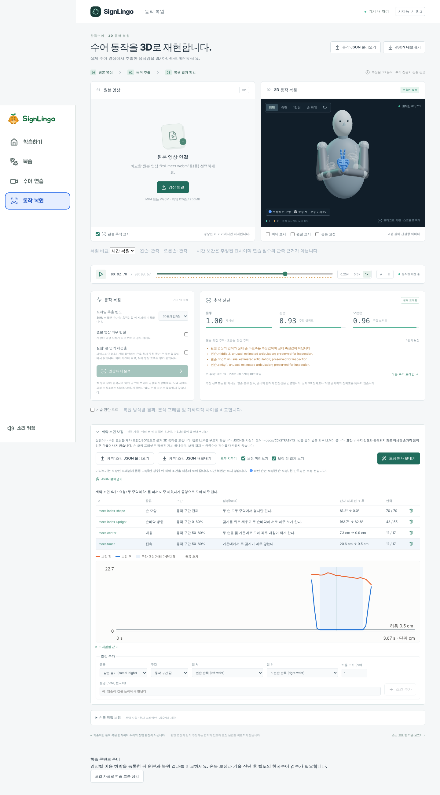

# 제약 조건 보정 (`signlingo.constraints` v1)

완성된 3D 동작(MotionClip)을 **제약 조건**으로 후보정합니다. 제약 조건은 "이 구간에서 양손이 같은 높이", "이 구간에서 두 검지가 닿는다"처럼 결과가 지켜야 할 조건을 적은 JSON 문서입니다. 같은 문서와 같은 해결기를 두 흐름에서 씁니다.

- **(a) 사후 수정**: 사람이 말로 수정 사항을 설명합니다(예: "만나다에서 양손이 같은 높이에서 마주 만나야 한다"). LLM이 그 말을 제약 조건 JSON으로 바꿉니다. Motion Lab에서 미리 본 뒤 보정본을 내보냅니다.
- **(b) 사전 의도**: 검수자의 설명 문구로 제약 조건을 미리 써 둡니다. `motion:batch --constraints`가 인식 직후 자동으로 적용합니다.

앱은 백엔드가 없는 정적 사이트입니다. **앱 안에서 LLM을 부르지 않고 API 키도 없습니다.** LLM은 앱 밖에서 이 문서를 읽고 JSON을 쓰는 일만 합니다. 이 문서 하나만 LLM에 붙여 넣으면 올바른 JSON을 쓸 수 있도록 형식 전체를 싣습니다.

## 0. LLM 출력 규칙

이 문서를 받은 LLM은 다음을 지킵니다.

1. **JSON 문서 하나만** 출력합니다. 앞뒤 설명 문장을 붙이지 않습니다.
2. 이 문서에 있는 필드와 값만 씁니다. 모든 객체는 엄격하게 검사하므로, 없는 필드나 오타가 하나라도 있으면 문서 전체가 거부됩니다.
3. 조건마다 사람이 읽을 **`note`(한국어)** 를 씁니다. 무엇을 왜 고정하는지 한 문장으로 씁니다.
4. 손가락은 해부학 이름 `thumb`(엄지) · `index`(검지) · `middle`(중지) · `ring`(약지) · `pinky`(새끼)로만 씁니다. 설명에 "1지"처럼 번호로 적힌 손가락은 [11. 손가락 번호 변환표](#11-손가락-번호-변환표)로 바꿉니다.
5. 왼쪽·오른쪽은 **수어하는 사람 기준**입니다(화면 기준이 아닙니다). 설명에 "오른손"이면 `right`입니다.
6. 프레임 번호나 시각(초)이 주어지면 `frames`·`ms` 구간을 씁니다. 주어지지 않으면 `phase`·`fraction` 구간을 씁니다([4. 구간](#4-구간-span)).
7. **시각을 지어내지 않습니다.** "두 번 댄다"처럼 반복되는 접촉은 시각이 주어지지 않으면 `contact`를 넣지 않고 손 모양·방향만 씁니다. 관측된 움직임(두 번 대는 동작)은 그대로 남습니다.
8. 표정·입 모양·눈썹·고개·시선·몸통 기울기 같은 **비수지 신호는 쓸 수 없습니다.** 요청에 있어도 조건으로 만들지 않습니다.
9. 손가락을 하나씩 접는 식의 **세밀한 손가락 움직임은 만들 수 없습니다.** `handshape`는 구간 동안 손 모양 하나를 정할 뿐입니다. 손 모양이 바뀌는 동작은 구간을 나눠 손 모양 두 개로 씁니다.
10. `id`는 영어 소문자·숫자·하이픈(최대 64자)이며 문서 안에서 겹치지 않아야 합니다.
11. 기본값과 같은 필드는 생략해도 됩니다.
12. 요청에 프레임 번호나 시각이 있으면 그 범위를 그대로 씁니다. 요청 원문은 `request`에 그대로 옮깁니다.

## 1. 쓰는 곳

| 흐름 | 방법 |
| --- | --- |
| Motion Lab (사후 수정) | 동작 JSON을 불러온 뒤 **제약 조건 보정** 패널에서 JSON을 불러오거나 붙여 넣습니다. 목록에서 추가·삭제할 수 있습니다. **보정 미리보기**는 원본과 보정 결과를 겹쳐 보여 주고, 조건별 잔차 그래프를 그립니다. **보정본 내보내기**를 누르면 `<영상 이름>.constrained.motion.json`을 내려받습니다. |
| 콘텐츠 패키지 | `npm run content -- constrain private-data/<id> <constraints.json>`: 패키지 동작에 적용하고 prepare를 다시 실행합니다(검수 초기화, `inspection.json` 재생성). [콘텐츠 준비·검수·공개](CONTENT_PUBLISHING.md) |
| 일괄 처리 (사전 의도) | `npm run motion:batch -- <영상 또는 폴더> --out <폴더> --constraints <폴더>`: 영상 `ksl-meet.webm`에는 `<폴더>/ksl-meet.constraints.json`을 인식 직후 적용합니다. 파일이 없는 영상은 그대로 저장합니다. [동작 일괄 처리](MOTION_BATCH.md) |
| 보고서 | `npm run motion:constrain-report -- <motion.json> <constraints.json>`: 적용 전후 잔차, 바뀐 관절·프레임 수를 `work/constraint-report.md`와 `work/constraint-report.json`에 씁니다. |

코스 1의 설명 문구를 옮긴 예시는 [`docs/constraints/`](constraints/)에 있습니다. 파일 이름이 배치 규칙(`<영상 이름>.constraints.json`)과 같습니다.



## 2. 한계

- **표정·비수지 신호는 만들지 않습니다.** 얼굴은 추정하지 않으며(`nonmanual.face: not-estimated`), 머리 방향도 바꾸지 않습니다.
- **관측되지 않은 미세한 손가락 움직임은 만들지 않습니다.** 손 모양 프리셋은 정해진 자세 하나이며 구간 동안 그대로입니다.
- 두 손이 맞닿는 조건은 아바타 손 부피가 허락하는 곳까지만 모읍니다. 예를 들어 손바닥이 마주 보는 두 `index` 손은 접은 손가락 마디가 먼저 닿아 검지끼리는 닿지 않습니다.
- 위치 조건(`sameHeight`·`contact`·`symmetry`·`hold`)은 **그 프레임에 관측되었거나 짧게 유지(held)된 손만** 옮깁니다. 검출되지 않은 손은 팔이 보여도 옮기지 않습니다. 복원기가 숨긴 팔은 만들지 않습니다.
- 손 모양(`handshape`)은 관측이 없던 손에도 값을 정할 수 있습니다. 그 값은 `constrained`(관측 아님)로 기록되고, 화면에 파란 손 "보정한 손 모양"으로 표시됩니다.
- 보정은 아바타 기하를 바꿀 뿐, **한국수어로서 맞는지 판정하지 않습니다.** 보정본은 새 revision이며 두 검수를 다시 받아야 합니다.
- 연습(Practice) 비교는 랜드마크 관측값을 쓰므로 보정의 영향을 받지 않습니다.

## 3. 문서 형식

```text
{
  "format": "signlingo.constraints",   // 필수, 고정
  "version": 1,                         // 필수, 고정
  "expression": "ksl-meet",             // 선택: 표현 id. content constrain에서 패키지 id와 같아야 합니다.
  "request": "원문 설명 또는 수정 요청",    // 선택: 최대 4000자
  "constraints": [ 조건, ... ]           // 필수: 1–64개
}
```

| 필드 | 형식 | 설명 |
| --- | --- | --- |
| `format` | `"signlingo.constraints"` | 고정값 |
| `version` | `1` | 고정값 |
| `expression` | 문자열 `^[a-z][a-z0-9-]{1,79}$` | 선택. 예: `ksl-thanks` |
| `request` | 문자열(1–4000자) | 선택. 요청 원문 |
| `constraints` | 배열(1–64개) | 아래 조건 객체 |

## 4. 구간 (`span`)

모든 조건에는 `span`이 있습니다. 다음 네 가지 중 하나입니다.

| 형식 | 예 | 뜻 |
| --- | --- | --- |
| `{"frames": [a, b]}` | `{"frames": [40, 80]}` | 프레임 번호 a–b(양 끝 포함, 0부터). 클립보다 길면 끝에서 자릅니다. |
| `{"ms": [a, b]}` | `{"ms": [1200, 1800]}` | 클립 시각 a–b 밀리초 |
| `{"phase": "start" \| "middle" \| "end" \| "whole"}` | `{"phase": "end"}` | 자동으로 찾은 **수어 구간**을 3등분한 앞·가운데·뒤, 또는 전체 |
| `{"fraction": [a, b]}` | `{"fraction": [0.5, 0.8]}` | 수어 구간의 비율 a–b(0–1) |

- **수어 구간**(`signingInterval`, `src/motion/signing.ts`)은 어느 한 손이라도 쉬는 자리에서 **10 cm 넘게 올라간** 첫 프레임부터 마지막 프레임까지입니다. 쉬는 자리는 그 팔이 처음(끝) 보인 세 프레임의 손목 위치이고(어깨선보다 35 cm 넘게 아래일 때), 아니면 몸 옆 기본 위치입니다. 단안 깊이는 잡음이 커서 앞뒤 거리는 절반만 셉니다. 90 ms보다 짧게 올라간 것은 추적 잡음으로 봅니다. 그래서 수어 앞뒤의 쉬는 시간은 구간 밖이고, 손 모양·방향 조건이 쉬는 손에 적용되지 않습니다.
- 올라간 손이 없으면 Practice의 동작 구간 추정(`activeInterval`)을 씁니다. 해결기 v1(개정판 2까지)은 이 추정을 썼는데, 공개된 ksl-thanks·ksl-sorry에서는 쉬는 손의 작은 흔들림 때문에 클립 전체가 구간이 되어 쉬는 손에도 조건이 걸렸습니다.
- 구간을 3등분한 위치가 실제 동작 단계와 다를 수 있습니다(예: 손이 올라가자마자 목표에 닿고 내리는 시간이 긴 경우). 그럴 때는 저장된 동작에서 잰 `frames` 구간을 씁니다([예시 2](#예시-2--미안-ksl-sorry-검토-후-수정)).
- 설명만 있고 시각이 없을 때의 권장 구간
  - 처음부터 끝까지 유지되는 손 모양·방향: `{"phase": "whole"}`
  - "A 했다가 B 한다"의 A: `{"phase": "start"}` 또는 `{"fraction": [0, 0.5]}`, B: `{"phase": "end"}` 또는 `{"fraction": [0.5, 1]}`
  - "A 했다가 B에 대고 C 한다"처럼 세 단계: `start` · `middle` · `end`
  - 마지막 자세에서의 접촉·위치(손을 내리기 전): `{"fraction": [0.5, 0.8]}`
- **섞임(blend)은 구간 안쪽에서만** 일어납니다. 구간 시작에서 가중치 0으로 시작해 `blendMs` 동안 1로 오르고, 끝나기 `blendMs` 전부터 0으로 내려갑니다(smoothstep). 그래서 **구간 밖 프레임은 절대 바뀌지 않고**, 구간의 첫·끝 프레임도 거의 바뀌지 않습니다. 끝 프레임까지 완전히 적용하려면 `"blendMs": 0`을 씁니다. 구간이 `2 × blendMs`보다 짧으면 섞임 길이를 구간의 절반으로 줄입니다.

## 5. 공통 필드

| 필드 | 형식 | 기본값 | 뜻 |
| --- | --- | --- | --- |
| `id` | `^[a-z0-9][a-z0-9-]{0,63}$` | 필수 | 문서 안에서 고유 |
| `kind` | 아래 7종 | 필수 | 조건 종류 |
| `span` | [4. 구간](#4-구간-span) | 필수 | 적용 구간 |
| `blendMs` | 0–1000 | `100` | 구간 안쪽 섞임 길이(밀리초) |
| `strength` | 0–1 | `1` | 보정 비율. 0.5면 필요한 보정의 절반만 적용 |
| `note` | 한국어 1–500자 | 필수 | 사람이 읽을 설명 |

## 6. 조건 종류

필드 이름은 정확히 아래와 같습니다. "잔차"는 목표 대비 남은 오차이며 보고서·그래프에 프레임별로 나옵니다.

### `sameHeight` — 같은 높이

| 필드 | 형식 | 기본값 |
| --- | --- | --- |
| `points` | 점 이름 2–4개(겹치지 않게) | 필수 |
| `toleranceCm` | 0–30 | `1` |
| `move` | `"both"` \| `"left"` \| `"right"` | `"both"` |
| `maxShiftCm` | 0–60 | `15` |

- 지정한 점들의 높이(세로 좌표)를 맞춥니다. 손의 점은 움직이고, 몸 점(`head.chin` 등)은 고정 기준입니다. `move`가 `left`면 왼손만 움직입니다.
- 가장 적게 바꾸도록 허용 오차 안까지만 옮깁니다(두 점 높이 차가 `toleranceCm` 이하가 됨).
- 잔차: 점들 높이의 최댓값 − 최솟값(cm). 허용 오차 이하이면 만족.

### `contact` — 접촉

| 필드 | 형식 | 기본값 |
| --- | --- | --- |
| `a`, `b` | 점 이름(서로 다른 손이거나, 한쪽이 몸 점) | 필수 |
| `gapCm` | 0–30: 남길 거리 | `0` |
| `toleranceCm` | 0–30 | `1` |
| `move` | `"both"` \| `"left"` \| `"right"` | `"both"` |
| `maxShiftCm` | 0–60 | `15` |

- 두 점 사이 거리가 `gapCm + toleranceCm` 이하가 되도록 손을 옮깁니다. 양손이 움직이면 반씩 옮깁니다. 손 모양과 손 방향은 그대로 두고 손 전체를 평행 이동합니다.
- **두 손은 서로 파고들지 않습니다**(해결기 v2). 손을 모은 뒤 두 손의 부피(손가락·손바닥·손목)가 겹치면, 표면이 맞닿는 곳까지 양손을 벌립니다. 지정한 두 점보다 다른 곳(예: 주먹 쥔 손가락 마디)이 먼저 닿으면 그 프레임은 "다른 곳이 먼저 닿음"(`blocked`)으로 보고되고, 잔차는 남은 거리입니다.
- 손가락 점(`tip`·`mid`·`base`)은 **손가락 뼈 중심선** 위에 있습니다. 두 손가락 면이 맞닿게 하려면 `gapCm`을 1–1.5로 둡니다. 손바닥·손등·손날 점은 손 표면에 있으므로 `gapCm` 0이 맞닿음입니다.
- 같은 손의 두 점은 쓸 수 없습니다(손을 옮겨도 거리가 그대로입니다). 그런 경우는 `handshape`로 씁니다.
- 잔차: max(0, 거리 − gapCm)(cm). `toleranceCm` 이하이면 만족.

### `symmetry` — 대칭

| 필드 | 형식 | 기본값 |
| --- | --- | --- |
| `axis` | `"lateral"` \| `"vertical"` \| `"depth"` | `"lateral"` |
| `lead` | `"both"` \| `"left"` \| `"right"` | `"both"` |
| `orientation` | 참/거짓(`lateral`일 때만) | `lateral`이면 참 |
| `toleranceCm` | 0–30 | `1` |
| `maxShiftCm` | 0–60 | `15` |

- 두 손목 위치를 몸통 기준 좌표에서 맞춥니다.
  - `lateral`(좌우 거울): 몸 가운데 세로면에 비춘 모양. 높이·앞뒤가 같고 좌우 거리가 같습니다. `orientation`이 참이면 손바닥 방향도 거울로 맞춥니다(손가락은 바꾸지 않음).
  - `vertical`(위아래로 나란히): 좌우·앞뒤 위치가 같고 높이는 각자 유지(한 손이 다른 손 위).
  - `depth`(앞뒤로 나란히): 좌우·높이가 같고 앞뒤는 각자 유지(한 손이 다른 손 앞).
- `lead`가 `left`면 왼손을 기준으로 오른손만 맞추고, `both`면 양손이 가운데로 함께 움직입니다.
- 양손이 모두 관측된 프레임에서만 작동합니다. 잔차: 맞춰야 할 좌표의 거리(cm).

### `handshape` — 손 모양

| 필드 | 형식 | 기본값 |
| --- | --- | --- |
| `hand` | `"left"` \| `"right"` \| `"both"` | 필수 |
| `preset` | [10. 손 모양 프리셋](#10-손-모양-프리셋)의 id | 필수 |
| `fingers` | 손가락 이름 1–5개 | 다섯 손가락 모두 |

- 손가락 관절 회전을 프리셋 값으로 바꿉니다. `fingers`를 주면 그 손가락만 바꾸고 나머지는 관측값을 둡니다. 설명이 일부 손가락만 말할 때 씁니다.
- 관측이 없던 손(누락)에도 프리셋을 적용하며, 그 프레임은 `constrained`로 기록됩니다. 그런 손의 손바닥 방향은 `palmFacing`을 함께 쓰지 않으면 아래팔 방향을 그대로 따릅니다.
- 잔차: 지정한 손가락 관절의 프리셋과의 평균 각도 차(°). 2° 이하이면 만족.

### `palmFacing` — 손바닥 방향

| 필드 | 형식 | 기본값 |
| --- | --- | --- |
| `hand` | `"left"` \| `"right"` \| `"both"` | 필수 |
| `facing` | [9. 방향 이름](#9-방향-이름) 또는 `"other-hand"` | 필수 |
| `pointing` | [9. 방향 이름](#9-방향-이름)(손끝 방향) | 생략: 손끝 방향은 자유 |
| `toleranceDeg` | 0–90 | `15` |

- 손바닥이 `facing` 방향을 보게 손을 돌립니다. `pointing`을 주면 손끝이 그 방향을 향하도록 함께 맞춥니다(손바닥 방향과 수직인 성분만 씁니다. 손바닥 방향과 같은 방향이면 무시합니다). `other-hand`는 다른 손의 손바닥 가운데를 보게 합니다.
- 허용 각도 안까지만 돌립니다. 손목 관절 제한(굽힘 85°, 비틀림 ±160°) 때문에 덜 돌아간 프레임은 "손목 제한"으로 보고됩니다.
- 잔차: 손바닥 방향 각도 차와 손끝 방향 각도 차 중 큰 값(°).

### `hold` — 자세 유지

| 필드 | 형식 | 기본값 |
| --- | --- | --- |
| `hand` | `"left"` \| `"right"` \| `"both"` | 필수 |
| `parts` | `"position"`, `"orientation"`, `"handshape"` 중 1–3개 | 셋 다 |
| `reference` | `"mean"` \| `"start"` \| `"end"` | `"mean"` |
| `maxShiftCm` | 0–60 | `15` |

- 구간 동안 손을 한 자세로 고정합니다. 기준 자세는 구간 안 관측 프레임의 평균(`mean`), 첫 프레임(`start`) 또는 마지막 프레임(`end`)입니다. 위치는 화면 공간(월드) 기준입니다.
- 움직임 자체를 지우므로, 설명이 "멈춘다", "그대로 둔다"고 할 때만 씁니다.
- 잔차: `position`이 있으면 기준 위치까지 거리(cm), 없으면 방향 각도 차(°).

### `wristOffset` — 손목 회전 보정

| 필드 | 형식 | 기본값 |
| --- | --- | --- |
| `hand` | `"left"` \| `"right"` | 필수 |
| `degrees` | `[굽힘, 비틀림, 편위]`, 각 −45–45 | 필수 |

- Motion Lab의 "손목 직접 보정"과 같은 의미입니다. 지금 손 방향에 손목 기준 회전을 더합니다.
  - 굽힘(+): 손바닥 쪽으로 꺾음. 음수는 손등 쪽.
  - 비틀림(+): 왼손은 손바닥이 새끼 쪽으로, 오른손은 손바닥이 검지 쪽으로 돕니다. 헷갈리면 `palmFacing`을 씁니다.
  - 편위(+): 왼손은 검지(엄지) 쪽으로, 오른손은 새끼 쪽으로 기웁니다.
- 잔차: 요청한 회전까지 남은 각도(°). 1° 이하이면 만족.

## 7. 점 이름표

손 점은 `<손>.<부위>` 또는 `<손>.<손가락>.<마디>`입니다. `<손>`은 `left` 또는 `right`입니다.

| 부위 | 뜻 |
| --- | --- |
| `wrist` | 손목 |
| `palm` | 손바닥 가운데(손바닥 표면) |
| `back` | 손등 가운데(손등 표면) |
| `pinkyEdge` | 새끼손가락 쪽 손날의 가운데 |
| `indexEdge` | 검지 쪽 손 옆면의 가운데 |

| 손가락 | 마디 | 뜻 |
| --- | --- | --- |
| `thumb`, `index`, `middle`, `ring`, `pinky` | `base` | 손가락 뿌리 마디(손바닥과 만나는 곳) |
| | `mid` | 첫째 마디 끝(가운데 마디 관절) |
| | `tip` | 손가락 끝 |

예: `right.index.tip`(오른손 검지 끝), `left.back`(왼손 손등), `right.pinkyEdge`(오른손 손날).

몸 점은 아바타 메시의 근사 위치이며 고정 기준으로만 씁니다. 실제 얼굴·몸을 측정한 값이 아닙니다.

| 이름 | 뜻 |
| --- | --- |
| `head.forehead` | 이마 |
| `head.nose` | 코 |
| `head.mouth` | 입 |
| `head.chin` | 턱 |
| `head.left`, `head.right` | 머리 왼쪽·오른쪽(관자놀이) |
| `body.chest` | 가슴 |
| `body.belly` | 배 |
| `body.leftShoulder`, `body.rightShoulder` | 왼어깨·오른어깨 |

## 8. 관절 이름 (기록·보고서)

보정본과 보고서는 바뀐 관절을 아바타 관절 이름으로 적습니다. 제약 조건 JSON에는 쓰지 않습니다.

| 이름 | 뜻 |
| --- | --- |
| `torso`, `head` | 몸통, 머리(제약 조건은 바꾸지 않음) |
| `<손>.upper` | 위팔 |
| `<손>.lower` | 아래팔 |
| `<손>.wrist` | 손목(손바닥 방향) |
| `<손>.<손가락>.0`, `.1`, `.2` | 손가락 뿌리 쪽부터 세 마디 |

## 9. 방향 이름

몸통 기준이며, 왼쪽·오른쪽은 수어하는 사람 기준입니다.

| 이름 | 뜻 |
| --- | --- |
| `up` / `down` | 위 / 아래 |
| `forward` | 앞(몸 바깥, 보는 사람 쪽) |
| `back` | 뒤(몸 쪽) |
| `left` / `right` | 수어자의 왼쪽 / 오른쪽 |
| `inward` | 몸 가운데 쪽(왼손은 오른쪽, 오른손은 왼쪽) |
| `outward` | 몸 바깥 옆쪽(왼손은 왼쪽, 오른손은 오른쪽) |
| `other-hand` | 다른 손 쪽(`facing`에서만) |

"손바닥이 마주 보게"는 `facing: "inward"`(양손이 몸 가운데 양쪽에 있을 때) 또는 `facing: "other-hand"`, "손등이 위"는 `facing: "down"`, "손끝이 밖으로"는 `pointing: "forward"`, "세운다"는 `pointing: "up"`입니다.

## 10. 손 모양 프리셋

| id | 이름 | 모양 |
| --- | --- | --- |
| `fist` | 주먹 | 네 손가락을 모두 접고 엄지를 접은 손가락 위에 댄다. |
| `flat` | 편손 | 다섯 손가락을 모두 펴서 붙인다. 엄지는 검지 옆에 붙인다. |
| `spread` | 편 손가락 벌리기 | 다섯 손가락을 모두 펴서 벌린다. |
| `bent` | 꺾은 편손 | 네 손가락을 붙인 채 뿌리 마디에서만 직각으로 꺾는다. 엄지는 검지 옆에 붙인다. |
| `index` | 검지 펴기 | 주먹에서 검지만 곧게 편다. |
| `index-middle` | 검지·중지 펴기 | 주먹에서 검지와 중지를 펴서 조금 벌린다. |
| `thumb` | 엄지 펴기 | 주먹에서 엄지만 곧게 세운다. |
| `pinky` | 새끼 펴기 | 주먹에서 새끼손가락만 곧게 편다. |
| `index-thumb-circle` | 검지·엄지 동그라미 | 검지 끝과 엄지 끝을 맞대어 동그라미를 만들고 나머지 손가락은 편다. |

프리셋은 손가락 관절 회전 표로 정의합니다(`src/motion/constraints/presets.ts`). 값은 왼손 기준 `굽힘(벌림)`°이며, 굽힘은 손바닥 쪽으로 접는 각도, 벌림은 엄지 쪽(+)·새끼 쪽(−)으로 기우는 각도입니다. 각 칸은 뿌리 마디 · 가운데 마디 · 끝 마디입니다. 오른손은 벌림 부호를 뒤집은 거울상입니다. 프리셋은 복원기의 손가락 관절 범위 안에 있습니다.

| 프리셋 | 엄지 | 검지 | 중지 | 약지 | 새끼 |
| --- | --- | --- | --- | --- | --- |
| `fist` | 0(-26) · 52 · 60 | 85 · 95 · 60 | 85 · 95 · 60 | 85 · 95 · 60 | 85 · 95 · 60 |
| `flat` | 0(+12) · 5 · 5 | 0 · 0 · 0 | 0 · 0 · 0 | 0 · 0 · 0 | 0 · 0 · 0 |
| `spread` | 12(+45) · 8 · 5 | 0(+10) · 0 · 0 | 0 · 0 · 0 | 0(-9) · 0 · 0 | 0(-18) · 0 · 0 |
| `bent` | 0(+12) · 5 · 5 | 85 · 0 · 0 | 85 · 0 · 0 | 85 · 0 · 0 | 85 · 0 · 0 |
| `index` | 0(-26) · 52 · 60 | 0 · 0 · 0 | 85 · 95 · 60 | 85 · 95 · 60 | 85 · 95 · 60 |
| `index-middle` | 0(-26) · 52 · 60 | 0(+8) · 0 · 0 | 0(-6) · 0 · 0 | 85 · 95 · 60 | 85 · 95 · 60 |
| `thumb` | 0(+22) · 0 · 0 | 85 · 95 · 60 | 85 · 95 · 60 | 85 · 95 · 60 | 85 · 95 · 60 |
| `pinky` | 0(-26) · 52 · 60 | 85 · 95 · 60 | 85 · 95 · 60 | 85 · 95 · 60 | 0 · 0 · 0 |
| `index-thumb-circle` | 36 · 12 · 10 | 45 · 60 · 40 | 0(-2) · 0 · 0 | 0(-8) · 0 · 0 | 0(-14) · 0 · 0 |

## 11. 손가락 번호 변환표

한국수어사전의 설명 문구는 손가락을 번호로 적습니다. **번호 표기는 이 표에만 있습니다.** 코드·JSON·프리셋 이름은 해부학 이름만 씁니다. 해석이 바뀌면 이 표만 고치고, 이 표에서 나온 예시(12장)를 다시 만듭니다.

| 설명 문구의 표기 | JSON의 손가락 |
| --- | --- |
| 1지 | `index` (검지) |
| 2지 | `middle` (중지) |
| 3지 | `ring` (약지) |
| 4지 | `pinky` (새끼) |
| 5지 | `thumb` (엄지) |

자주 나오는 표현

| 설명 문구 | JSON |
| --- | --- |
| 주먹의 1지를 편다 | `"preset": "index"` |
| 1·2지를 편다 | `"preset": "index-middle"` |
| 5지를 세운다 | `"preset": "thumb"` |
| 4지를 편다 | `"preset": "pinky"` |
| 1·5지 끝을 맞대어 동그라미 | `"preset": "index-thumb-circle", "fingers": ["index", "thumb"]` |
| 1·5지를 편다 | `"preset": "spread", "fingers": ["index", "thumb"]` |
| 4지 옆면(손날) | 점 `<손>.pinkyEdge` |
| 1지 옆면 | 점 `<손>.indexEdge` |
| 1지 끝 | 점 `<손>.index.tip` |

## 12. 자연어 → JSON 예시

예시 1–3은 공개된 코스 1의 검수자 설명 문구(`src/content/catalog.json`의 `description`)를 옮긴 것이며, [`docs/constraints/`](constraints/)의 파일과 같습니다. 손가락 이름은 11장의 변환표를 따른 결과입니다.

### 예시 1 · 고맙다 (ksl-thanks, 사전 의도)

> 손끝이 밖으로 향하게 펴서 모로 세운 오른손의 4지 옆면을 손바닥이 아래로 향하게 편 왼 손등에 두 번 댄다.

- 두 손 모두 편손이고, 오른손은 손끝이 앞(`pointing: forward`), 손바닥이 몸 가운데(`facing: inward`)를 보게 세웁니다. 왼손은 손바닥이 아래입니다. 설명에 처음부터 끝까지 유지되는 모양이므로 `whole`입니다.
- "두 번 댄다"의 접촉 시각은 설명에 없으므로 `contact`를 넣지 않습니다(규칙 7). 관측된 두 번의 움직임이 그대로 남습니다. 시각이 정해지면 예시 5처럼 사후 수정으로 더합니다.

```json
{
  "format": "signlingo.constraints",
  "version": 1,
  "expression": "ksl-thanks",
  "request": "손끝이 밖으로 향하게 펴서 모로 세운 오른손의 4지 옆면을 손바닥이 아래로 향하게 편 왼 손등에 두 번 댄다.",
  "constraints": [
    {
      "id": "thanks-right-flat",
      "kind": "handshape",
      "span": { "phase": "whole" },
      "hand": "right",
      "preset": "flat",
      "note": "오른손은 다섯 손가락을 붙여 편다."
    },
    {
      "id": "thanks-right-edge-up",
      "kind": "palmFacing",
      "span": { "phase": "whole" },
      "hand": "right",
      "facing": "inward",
      "pointing": "forward",
      "toleranceDeg": 25,
      "note": "오른손은 손끝이 앞(몸 바깥)을 향하고, 손바닥이 몸 가운데 쪽을 보게 모로 세운다."
    },
    {
      "id": "thanks-left-flat",
      "kind": "handshape",
      "span": { "phase": "whole" },
      "hand": "left",
      "preset": "flat",
      "note": "왼손은 다섯 손가락을 붙여 편다."
    },
    {
      "id": "thanks-left-palm-down",
      "kind": "palmFacing",
      "span": { "phase": "whole" },
      "hand": "left",
      "facing": "down",
      "toleranceDeg": 25,
      "note": "왼손은 손바닥이 아래를 보게 하여 손등이 위로 오게 한다."
    }
  ]
}
```

### 예시 2 · 미안 (ksl-sorry, 검토 후 수정)

> 오른손의 1·5지 끝을 맞대어 동그라미를 만들어 이마에 댔다가 1·5지를 펴며 내린다.

- 세 단계(동그라미 → 이마에 댄다 → 펴며 내린다)입니다. 설명만으로 쓴 처음 문서(개정판 2)는 `start`·`middle`·`end`에 대응시켰습니다.
- 개정판 2 검토 소견: "동그라미를 이마에 댄 장면 앞뒤만 자연스럽고 나머지는 부자연스럽다." 이 클립에서는 손이 올라가자마자 이마에 닿고(1.47–1.80초) 내리는 시간이 길어서, 수어 구간을 3등분한 `middle`이 이마 장면보다 늦습니다. 그래서 **원본 관측에서 잰 프레임**으로 구간을 씁니다(규칙 6·12). 손끝이 이마에 가장 가까운 프레임 44–54를 가운데에 둡니다. 이 프레임은 지어낸 시각이 아니라 저장된 동작에서 잰 값이며, 검수자가 원본 영상과 맞는지 확인합니다.
- 개정판 3 검토 소견: "펴면서 내리고, 쉬는 자리에서 손 모양이 자연스러워야 한다." 펴기를 이마에서 뗄 때(56)부터 300 ms에 걸쳐 섞어 내리면서 펴지게 하고, 동그라미는 펴기가 다 섞인 뒤(68)까지 겹쳐 두어 그 사이에 관측값이 끼지 않게 합니다. 쉬는 자리에서 편안한 손으로 풀리는 것은 학습 화면의 쉬는 자세 단계가 합니다.
- 처음 문서는 설명이 말한 검지·엄지만 바꾸고 나머지 손가락은 관측값을 두었지만, 이 클립에서는 그 관측값이 프레임마다 최대 137° 튀었습니다. 그래서 동그라미(나머지 손가락은 편다)와 펴기 모두 다섯 손가락을 프리셋으로 정합니다.
- 이마 접촉은 오른손만 옮깁니다(`move: right`). 단안 깊이 추정으로 손이 얼굴 앞 약 38 cm에 복원되어 있어 `maxShiftCm`를 45로 늘리고, 손이 갑자기 끌려가지 않도록 `blendMs` 250으로 섞습니다.

```json
{
  "format": "signlingo.constraints",
  "version": 1,
  "expression": "ksl-sorry",
  "request": "오른손의 1·5지 끝을 맞대어 동그라미를 만들어 이마에 댔다가 1·5지를 펴며 내린다. (개정판 2 검토: 동그라미를 이마에 댄 장면 앞뒤만 자연스럽고 나머지 구간은 손이 부자연스럽다. 구간을 원본 관측에서 손끝이 이마에 가장 가까운 프레임 44–54 기준으로 다시 잡는다. 개정판 3 검토: 펴면서 내리고, 쉬는 자리에서는 손 모양이 자연스러워야 한다.)",
  "constraints": [
    {
      "id": "sorry-circle",
      "kind": "handshape",
      "span": { "frames": [36, 68] },
      "hand": "right",
      "preset": "index-thumb-circle",
      "note": "손을 올리기 시작할 때(프레임 36)부터 내리며 펴기가 끝날 때(68)까지 검지 끝과 엄지 끝을 맞댄 동그라미, 나머지 손가락은 편다. 나머지 손가락의 관측값은 프레임마다 크게 튀어(최대 137°) 프리셋으로 정한다."
    },
    {
      "id": "sorry-forehead",
      "kind": "contact",
      "span": { "frames": [38, 60] },
      "blendMs": 250,
      "a": "right.index.tip",
      "b": "head.forehead",
      "move": "right",
      "gapCm": 1,
      "toleranceCm": 1.5,
      "maxShiftCm": 45,
      "note": "동그라미를 이마에 댄다. 손끝이 이마에 가장 가까운 프레임 44–54가 가운데에 오도록 잡았다. 단안 깊이 추정으로 손이 얼굴 앞 약 38 cm에 복원되어 이동 상한을 45 cm로 늘리고, 250 ms에 걸쳐 섞는다."
    },
    {
      "id": "sorry-open",
      "kind": "handshape",
      "span": { "frames": [56, 90] },
      "blendMs": 300,
      "hand": "right",
      "preset": "spread",
      "note": "이마에서 떼면서(프레임 56) 300 ms에 걸쳐 손가락을 펴고, 편 채로 내린다. 손이 쉬는 자리에 닿을 무렵에는 학습 화면이 편안한 손으로 풀어 준다."
    }
  ]
}
```

### 예시 3 · 만나다 (ksl-meet, 사전 의도)

> 두 주먹의 1지를 펴서 마주 세웠다가 중앙으로 모아 마주 댄다.

- 두 손 모두 검지 펴기이고, 검지를 세우고(`pointing: up`) 손바닥이 마주 보게(`facing: inward`) 합니다. 손을 내리기 시작하는 마지막 부분은 빼고 `fraction [0, 0.8]`입니다.
- "중앙으로 모아 마주 댄다"는 마지막 자세입니다. 좌우 대칭(`symmetry lateral`)으로 가운데에 모으고, 두 검지 가운데 마디가 닿게 합니다(`contact`, 손가락 면이 닿도록 `gapCm` 1.5). 구간은 `fraction [0.5, 0.8]`입니다.
- 해결기 v2에서 두 손은 서로 파고들지 않습니다. 손바닥이 마주 보는 두 `index` 손은 접은 손가락 마디가 먼저 닿으므로, 그 자리에서 멈추고 `meet-touch`는 "다른 곳이 먼저 닿음"으로 남습니다(검지 가운데 마디 사이 약 11 cm). 개정판 2(v1)는 이 접촉을 맞추느라 두 손목이 겹쳐 손이 서로 파고들었습니다. 검지끼리 닿아야 한다면 손 방향을 바꿔야 하므로 검수자가 정합니다.

```json
{
  "format": "signlingo.constraints",
  "version": 1,
  "expression": "ksl-meet",
  "request": "두 주먹의 1지를 펴서 마주 세웠다가 중앙으로 모아 마주 댄다.",
  "constraints": [
    {
      "id": "meet-index-shape",
      "kind": "handshape",
      "span": { "phase": "whole" },
      "hand": "both",
      "preset": "index",
      "note": "두 손 모두 주먹에서 검지만 편다."
    },
    {
      "id": "meet-index-upright",
      "kind": "palmFacing",
      "span": { "fraction": [0, 0.8] },
      "hand": "both",
      "facing": "inward",
      "pointing": "up",
      "toleranceDeg": 20,
      "note": "검지를 위로 세우고 두 손바닥이 서로 마주 보게 한다."
    },
    {
      "id": "meet-center",
      "kind": "symmetry",
      "span": { "fraction": [0.5, 0.8] },
      "axis": "lateral",
      "toleranceCm": 2,
      "note": "두 손을 몸 가운데로 모아 좌우 대칭이 되게 한다."
    },
    {
      "id": "meet-touch",
      "kind": "contact",
      "span": { "fraction": [0.5, 0.8] },
      "a": "left.index.mid",
      "b": "right.index.mid",
      "gapCm": 1.5,
      "toleranceCm": 0.5,
      "note": "가운데에서 두 검지가 마주 닿는다."
    }
  ]
}
```

### 예시 4 · 사후 수정: 같은 높이에서 마주 만나기

> 만나다에서 양손이 같은 높이에서 마주 만나야 한다.

- 시각이 없으므로 마지막 자세 구간 `fraction [0.5, 0.8]`을 씁니다. 높이는 두 검지 끝으로 맞추고, 만남은 검지 가운데 마디 접촉으로 씁니다.

```json
{
  "format": "signlingo.constraints",
  "version": 1,
  "expression": "ksl-meet",
  "request": "만나다에서 양손이 같은 높이에서 마주 만나야 한다.",
  "constraints": [
    {
      "id": "meet-same-height",
      "kind": "sameHeight",
      "span": { "fraction": [0.5, 0.8] },
      "points": ["left.index.tip", "right.index.tip"],
      "toleranceCm": 1,
      "note": "만날 때 두 검지 끝의 높이가 같다."
    },
    {
      "id": "meet-touch",
      "kind": "contact",
      "span": { "fraction": [0.5, 0.8] },
      "a": "left.index.mid",
      "b": "right.index.mid",
      "gapCm": 1.5,
      "toleranceCm": 0.5,
      "note": "두 검지가 마주 닿는다."
    }
  ]
}
```

### 예시 5 · 사후 수정: 프레임을 알고 있는 반복 접촉

> 고맙다에서 48번째와 64번째 프레임쯤 오른손 손날이 왼손 손등에 닿아야 해요. 왼손은 움직이지 마세요.

- 두 번의 접촉을 각각 `frames` 구간으로 씁니다(주어진 프레임 ±3). 왼손은 고정이므로 `move: right`입니다. 짧은 구간이라 섞임을 60 ms로 줄입니다.

```json
{
  "format": "signlingo.constraints",
  "version": 1,
  "expression": "ksl-thanks",
  "request": "고맙다에서 48번째와 64번째 프레임쯤 오른손 손날이 왼손 손등에 닿아야 해요. 왼손은 움직이지 마세요.",
  "constraints": [
    {
      "id": "thanks-tap-1",
      "kind": "contact",
      "span": { "frames": [45, 51] },
      "blendMs": 60,
      "a": "right.pinkyEdge",
      "b": "left.back",
      "move": "right",
      "note": "첫 번째로 오른손 손날이 왼 손등에 닿는다."
    },
    {
      "id": "thanks-tap-2",
      "kind": "contact",
      "span": { "frames": [61, 67] },
      "blendMs": 60,
      "a": "right.pinkyEdge",
      "b": "left.back",
      "move": "right",
      "note": "두 번째로 오른손 손날이 왼 손등에 닿는다."
    }
  ]
}
```

### 예시 6 · 사후 수정: 시각 구간 동안 멈추기

> 1.2초부터 1.6초까지 오른손이 흔들리는데, 그 동안은 오른손을 그대로 멈춰 주세요.

```json
{
  "format": "signlingo.constraints",
  "version": 1,
  "request": "1.2초부터 1.6초까지 오른손이 흔들리는데, 그 동안은 오른손을 그대로 멈춰 주세요.",
  "constraints": [
    {
      "id": "right-still",
      "kind": "hold",
      "span": { "ms": [1200, 1600] },
      "hand": "right",
      "reference": "mean",
      "note": "1.2–1.6초 동안 오른손 위치·방향·모양을 그 구간 평균 자세로 고정한다."
    }
  ]
}
```

### 예시 7 · 사후 수정: 손목 각도

> 20번째부터 30번째 프레임까지 왼손목을 손바닥 쪽으로 15도 더 꺾어 주세요. 손 모양은 주먹이에요.

```json
{
  "format": "signlingo.constraints",
  "version": 1,
  "request": "20번째부터 30번째 프레임까지 왼손목을 손바닥 쪽으로 15도 더 꺾어 주세요. 손 모양은 주먹이에요.",
  "constraints": [
    {
      "id": "left-wrist-flex",
      "kind": "wristOffset",
      "span": { "frames": [20, 30] },
      "hand": "left",
      "degrees": [15, 0, 0],
      "note": "왼손목을 손바닥 쪽으로 15도 더 꺾는다."
    },
    {
      "id": "left-fist",
      "kind": "handshape",
      "span": { "frames": [20, 30] },
      "hand": "left",
      "preset": "fist",
      "note": "왼손은 주먹이다."
    }
  ]
}
```

### 예시 8 · 사후 수정: 좌우 대칭과 일부 손가락

> 양손이 처음부터 끝까지 좌우 대칭으로 움직이고, 양손 다 엄지와 검지만 펴 있어야 해요. 표정도 웃는 얼굴이어야 해요.

- 좌우 대칭은 `symmetry lateral`, 손 모양은 `index-thumb-circle`이 아니라 펴기이므로 `spread`에서 엄지·검지만 지정합니다. 나머지 손가락은 설명에 없으므로 관측값을 둡니다.
- 표정은 만들 수 없으므로 조건에 넣지 않습니다(규칙 8).

```json
{
  "format": "signlingo.constraints",
  "version": 1,
  "request": "양손이 처음부터 끝까지 좌우 대칭으로 움직이고, 양손 다 엄지와 검지만 펴 있어야 해요. 표정도 웃는 얼굴이어야 해요.",
  "constraints": [
    {
      "id": "mirror-hands",
      "kind": "symmetry",
      "span": { "phase": "whole" },
      "axis": "lateral",
      "lead": "both",
      "note": "양손 위치와 손바닥 방향을 좌우 거울 대칭으로 맞춘다. 표정은 조건으로 만들 수 없어 넣지 않았다."
    },
    {
      "id": "thumb-index-open",
      "kind": "handshape",
      "span": { "phase": "whole" },
      "hand": "both",
      "preset": "spread",
      "fingers": ["thumb", "index"],
      "note": "양손 엄지와 검지를 편다. 나머지 손가락은 관측값을 둔다."
    }
  ]
}
```

## 13. 해결기 (`src/motion/constraints/`)

순수 함수 `solveConstraints`가 프레임마다 다음 순서로 계산합니다. 입력은 바꾸지 않고, 바뀌지 않은 프레임은 같은 객체를 돌려줍니다.

1. 정방향 운동학으로 손목 위치, 손바닥의 월드 방향, 손가락 회전을 구합니다. 몸통이 없는 프레임은 건너뜁니다.
2. **방향 단계**(고정 순서): `hold` → `handshape` → `palmFacing` → `wristOffset` → `symmetry`(방향). 각 조건의 가중치(섞임 × `strength`)로 slerp합니다.
3. **위치 단계**: `hold`·`symmetry`·`sameHeight`·`contact`를 6회 번갈아 풀고(Gauss–Seidel), 매번 고정 팔 길이로 닿을 수 있는 범위로 손목 목표를 되돌립니다. 그 뒤 손마다 가장 큰 가중치로 섞고, 이동량을 `maxShiftCm` 이하로 자릅니다.
3a. **겹침 해소**(v2): 두 손이 모두 보이는 프레임에서 손 부피(`src/motion/handContact.ts`: 손가락 캡슐, 손바닥 캡슐 3개, 손목 구)가 겹치면, 겹침 법선들의 깊이 가중 평균 방향으로 양손을 반씩, 표면이 닿는 최소 거리만큼 평행 이동합니다(선 탐색). 좌우 대칭(`symmetry lateral`) 조건이 걸린 프레임은 몸통의 좌우 축으로만 벌려 대칭을 지킵니다.
4. 바뀐 팔만 기존 고정 길이 2관절 IK(`solveArm`, 원래 팔꿈치를 굽힘 평면 기준으로)로 다시 풀고, 복원기와 같은 방식(`distributeForearmRoll`)으로 손바닥 방향을 아래팔 roll과 손목에 나눕니다. 제약이 손바닥 방향을 정한 손은 손목 관절 제한(`boundWrist`)을 지킵니다. 위팔 0.28 m, 아래팔 0.26 m와 팔꿈치 굽힘 0.1–165°가 유지됩니다.
5. 최종 자세에서 잔차를 다시 재고, 프레임별 적용 내역(조건 id와 가중치, 바뀐 관절, 손별 근거)을 남깁니다.

## 14. 결과 기록 (MotionClip v2)

- **기준은 저장된 프레임**(손목 수동 보정 반영)입니다. 시간 복원·몸통 고정·손 채우기 같은 표시 후처리 결과는 파일에 넣지 않습니다.
- 보정본은 `version: 2`입니다. 이전 v1 파일과 0.2.0/0.3.0/0.3.1 클립은 그대로 읽습니다. 이전 앱은 v2를 읽지 않습니다(보정값을 관측값으로 오해하지 않도록).
- 그대로인 것: `pipeline`(0.2.0 등), 랜드마크, 손 배정, `quality`(손 상태), 경고, 복원 보정 기록.
- 새로 붙는 것
  - `constraints`: `document`(적용한 제약 조건 전체, 기본값 포함), `sha256`(문서의 canonical JSON SHA-256), `solver`(`signlingo-constraint-solver-v2`. v1은 개정판 2까지의 기록), `sourceEdits`(원래 손목 수동 보정. pose에 반영하고 `edits`는 비움), `summary`(조건별 잔차 요약).
  - 바뀐 프레임의 `constraint`: `applied`(조건 id와 가중치), `joints`(바뀐 관절), `original`(그 관절들의 원래 회전), `evidence`(손별 `observed` = 관측된 손을 보정 / `constrained` = 관측이 없던 손에 만든 값).
- 원래 v1 클립은 `original`과 `sourceEdits`로 정확히 되살릴 수 있습니다. 보정본에 다시 적용하면 원본에서 다시 계산하므로 보정이 겹치지 않습니다.
- 콘텐츠 항목에는 `constraints: { sha256, count }`가 기록되고 **review subject에 포함**됩니다. 보정하면 기존 승인은 자동으로 무효가 됩니다. 학습 화면의 `parseLessonMotion`은 v2를 읽고, 항목과 파일의 해시가 다르면 거부합니다.
- 화면: 제약이 손 모양을 정한 손은 `constrained` 상태로 파란 손이며 범례 "보정한 손 모양"이 붙습니다. 손 채우기는 이 손을 덮어쓰거나 숨기지 않습니다.

## 15. 검증

- JSON 오류는 `constraints[2].preset: …`처럼 경로와 함께 보고됩니다. Motion Lab은 붙여 넣은 JSON을 바로 검사합니다.
- `npm run motion:constrain-report -- <motion.json> <constraints.json>`으로 조건별 잔차(전·후, 만족 프레임), 측정 불가·도달 불가·이동 상한·손목 제한 프레임 수, 바뀐 관절과 프레임 수, 구간 밖 변경 수(0이어야 함), 팔 길이 오차를 확인합니다.
- `tests/constraint-tools.test.ts`가 이 문서의 JSON 예시를 모두 스키마로 검사하고, 예시 1–3이 `docs/constraints/`의 파일과 같은지, 프리셋 표가 코드와 같은지 확인합니다. 해결기·보정본·표시 단계는 `tests/constraints.test.ts`가 합성 클립으로 확인합니다.
